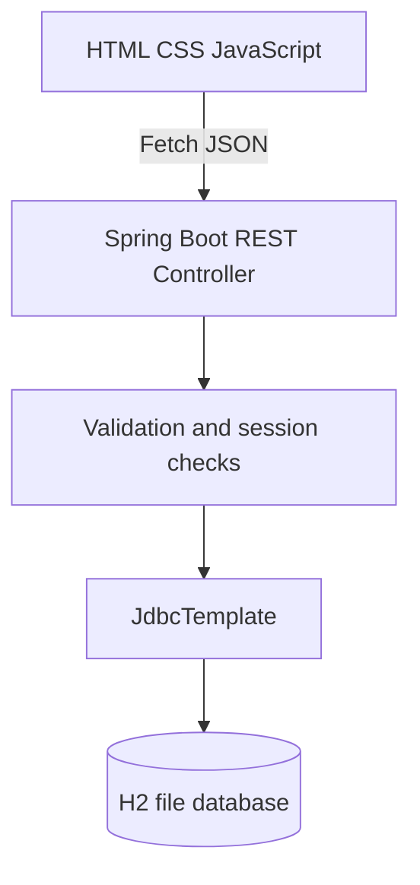

# LifeFlow — Java External Viva Guide

## 60-second introduction

“LifeFlow is a Java Spring Boot-based blood donation management demonstration inspired by e-RaktKosh. It helps users search fictional blood inventory, register donor accounts, book appointments, create blood requests and register for camps. The backend exposes REST endpoints, uses JDBC through Spring's JdbcTemplate, and persists data in an H2 relational database. The responsive frontend uses HTML, CSS and JavaScript.”

## Java concepts demonstrated

- **Class:** `LifeFlowApplication`, `Api`, `ApiError`.
- **Object:** `new BCryptPasswordEncoder()` creates an encoder object.
- **Encapsulation:** API methods keep database and validation logic in the backend rather than the UI.
- **Inheritance:** `ApiError extends RuntimeException`.
- **Polymorphism:** `ApiError` is handled by Spring's exception-handler mechanism as an exception type.
- **Abstraction:** `JdbcTemplate` abstracts JDBC connection/statement boilerplate.
- **Collections:** `List`, `Map`, `List.of()`, `Map.of()`.
- **Exceptions:** custom `ApiError`, `@ExceptionHandler`.
- **Packages:** `com.lifeflow`.
- **Annotations:** `@SpringBootApplication`, `@RestController`, `@GetMapping`, `@PostMapping`, `@Autowired`, `@Bean`.
- **Database:** JDBC via Spring JdbcTemplate and H2.
- **Security:** BCrypt password hashing and session-based login; authorization check for admin endpoints.

## Database entities (tables)

- `users`: donor/admin accounts
- `banks`: fictional blood centres
- `inventory`: group, component, units and bank relationship
- `appointments`: bookings per user and centre
- `requests`: blood requests and review status
- `camps`: upcoming sample events
- `camp_signups`: user/camp registrations

## Architecture

## Sample viva questions

1. **What is Spring Boot?** A framework that simplifies building Java applications and REST APIs.
2. **What is a REST API?** An HTTP interface that lets the frontend request or modify data.
3. **What is JDBC?** Java Database Connectivity, used to communicate with relational databases.
4. **What is JdbcTemplate?** A Spring helper that reduces repetitive JDBC code.
5. **What is H2?** A lightweight relational database that can store data in a file.
6. **What is a primary key?** A unique identifier for a table row.
7. **What is a foreign key?** A field linking one table to another.
8. **What is CRUD?** Create, Read, Update, Delete.
9. **What is encapsulation?** Keeping implementation details inside a class or module.
10. **What is inheritance?** One class extending another, like `ApiError extends RuntimeException`.
11. **What is polymorphism?** Treating objects of different subtypes through a common parent type.
12. **What is abstraction?** Hiding implementation details behind a simpler interface.
13. **What is an exception?** An object representing an error during execution.
14. **What is a constructor?** A special method used to initialize an object.
15. **What is an annotation?** Metadata such as `@GetMapping` that frameworks can interpret.
16. **What is dependency injection?** Supplying required objects, for example via `@Autowired`.
17. **What is Maven?** A Java build and dependency management tool.
18. **What is BCrypt?** A password hashing algorithm designed to make password guessing expensive.
19. **Why hash passwords?** So plaintext passwords are not stored in the database.
20. **What is a session?** Server-side state associated with a user's browser session.
21. **What is JSON?** A structured text format used between the frontend and API.
22. **What is HTTP GET?** A request method commonly used to retrieve data.
23. **What is HTTP POST?** A request method commonly used to submit data.
24. **What is SQL?** A language for interacting with relational databases.
25. **What is SQL injection?** Malicious input interpreted as SQL; parameterized queries help prevent it.
26. **How is inventory searched?** SQL joins inventory and banks, filtering by city, group and component.
27. **How are appointments stored?** As rows linked to a user and blood centre.
28. **How is admin access checked?** The API checks the logged-in user's `ROLE` before admin operations.
29. **Why is this demo not for emergencies?** The centres and stock are fictional and not medically verified.
30. **What would you improve next?** Role-scoped administration, concurrency-safe booking, PostgreSQL, CSRF protection and notifications.

## Two-minute demonstration

1. Open the home page and show the responsive layout.
2. Search O+ in Vijayawada; point out the demo disclaimer.
3. Register a donor and open the dashboard.
4. Book a future appointment and show it under My Appointments.
5. Submit a sample blood request.
6. Sign out and log in as the seeded administrator.
7. Review the request and update its status.
8. Update a fictional stock count, then search again to show persistence.

## Be precise in your viva

This version uses **Spring JDBC**, not JPA or Hibernate. It uses **vanilla JavaScript**, not React. It demonstrates basic server sessions but is **not production-hardened**.
